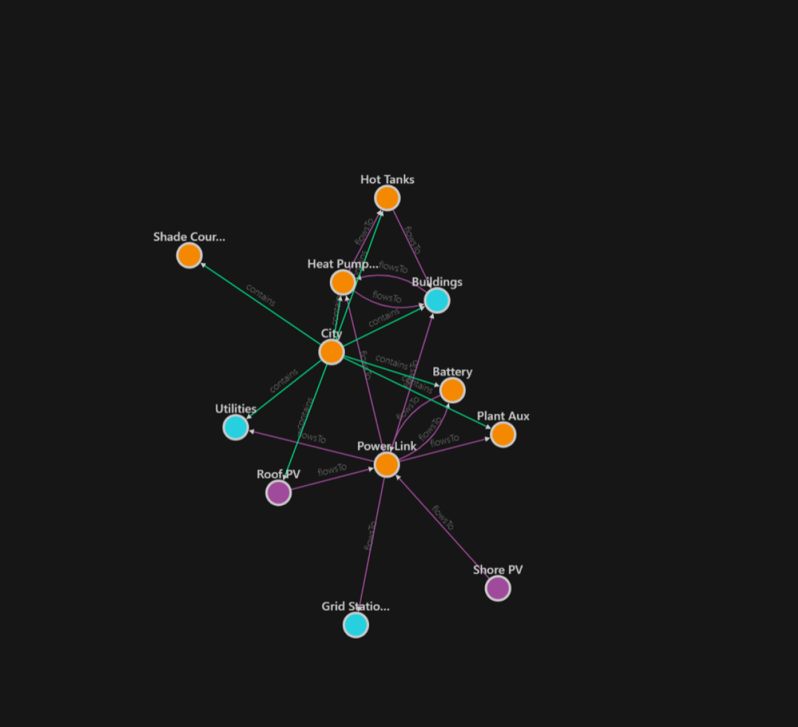
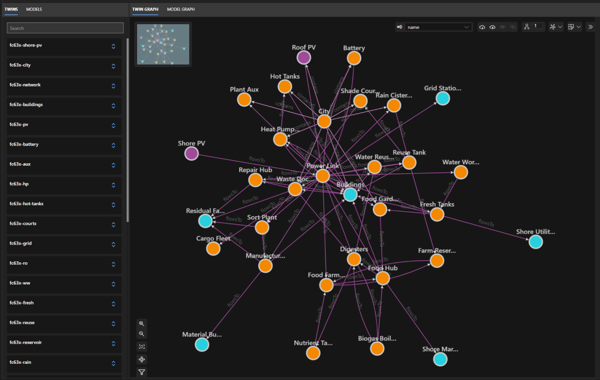
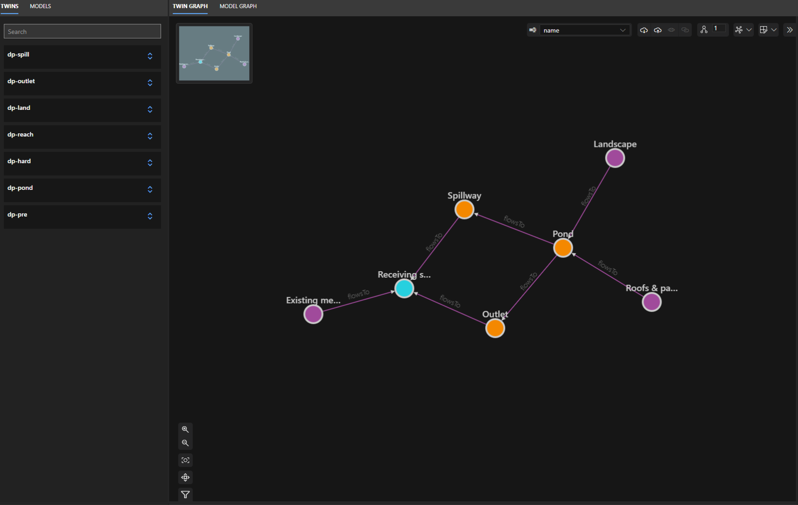

# Systems Thinking Agent Twin Demo

(Early Research Demo) Turn a text brief into integrated environmental systems digital twins using an input–output, stock–flow metabolism model.

## From a Brief to Twin: How Environmental Metabolism Guides Environmental Twin System Generation

Urban metabolism, rooted in Abel Wolman's [*The Metabolism of Cities* (1965)](https://doi.org/10.1038/scientificamerican0965-178), describes cities through resource inputs, transformations, stocks, and outputs. These concepts give an AI agent a vocabulary for reasoning about how environmental systems work together.

The framework uses this vocabulary for **knowledge-guided twin generation** ([Ding, 2024](https://kilthub.cmu.edu/articles/thesis/Generative_AI_for_Critical_Digital_Twins/25892518)): from a design brief, the agent identifies infrastructure and resource exchanges, checks them against physical balances and design requirements, and maps them into a twin. Assets become entities, stored resources become properties, and transfers become connections—making the proposed system's logic and assumptions available to inspect and refine.

## Try it yourself

1. **Load the agent skill.** In a ChatGPT environment with Skills enabled, import the [Environmental Metabolism Modeling skill](AgentTwin/skills/environmental-metabolism-modeling/), keeping `SKILL.md` and all supporting files together. If the upload option requires a ZIP, compress the complete skill folder before uploading.
2. **Try a template brief.** Select the skill and fill in the fields below. Specify one system (such as energy) or several connected systems (such as energy, water, food, waste, and materials).

   > Design [goal] [system or systems] for [environment], occupying [land area and unit] and supporting [number of people].

3. **Open the twin.** In Azure Digital Twins Explorer, load the [model definition](AgentTwin/azure_dt_model_map.json), then import the generated `graph.json`.

## Three briefs to try

These are concept examples with stated assumptions, not live sensor models or construction-ready designs. The [examples](examples/) contain outputs generated by the ChatGPT agent skill; follow step 3 to load their models and graphs into Azure Digital Twins Explorer and inspect the results. A successful balance check does not establish real-world feasibility; the packages record their limits and checks.

### 1. A net-positive city — energy

> Design a net-positive energy system for a floating city occupying 6.3 hectares and supporting 12,000 people.

### 2. A net-positive city — connected systems

> Design net-positive systems of waste, materials, energy, food, and water for a floating city occupying 6.3 hectares and supporting 12,000 people.

### 3. Green infrastructure — a detention pond

> Design a detention pond for a 10-hectare residential site with 60% impervious cover. Limit peak discharge to pre-development levels for the 2-, 10-, and 100-year storms, within a 0.5-hectare footprint.

